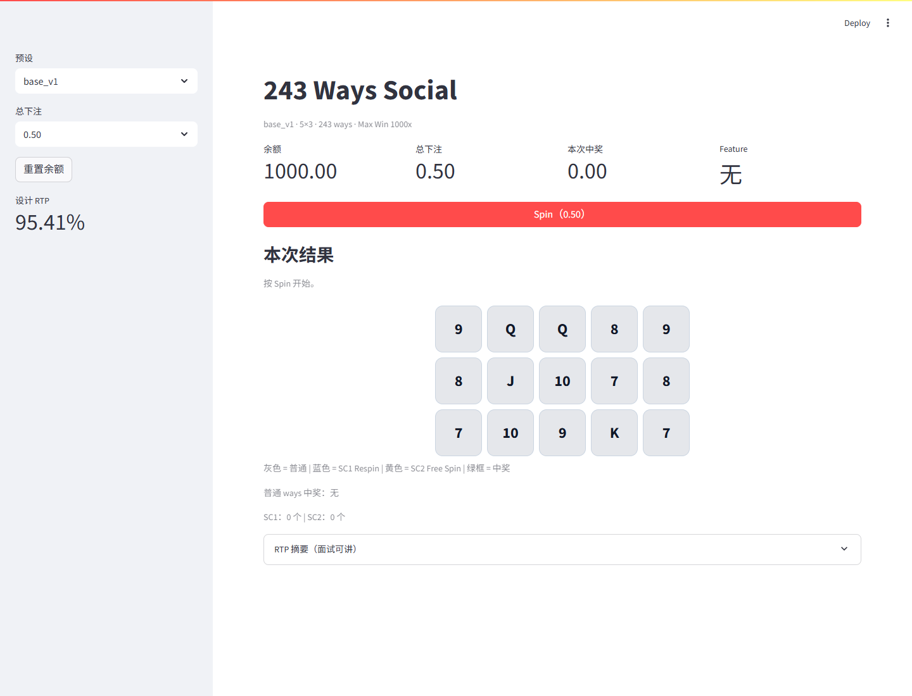
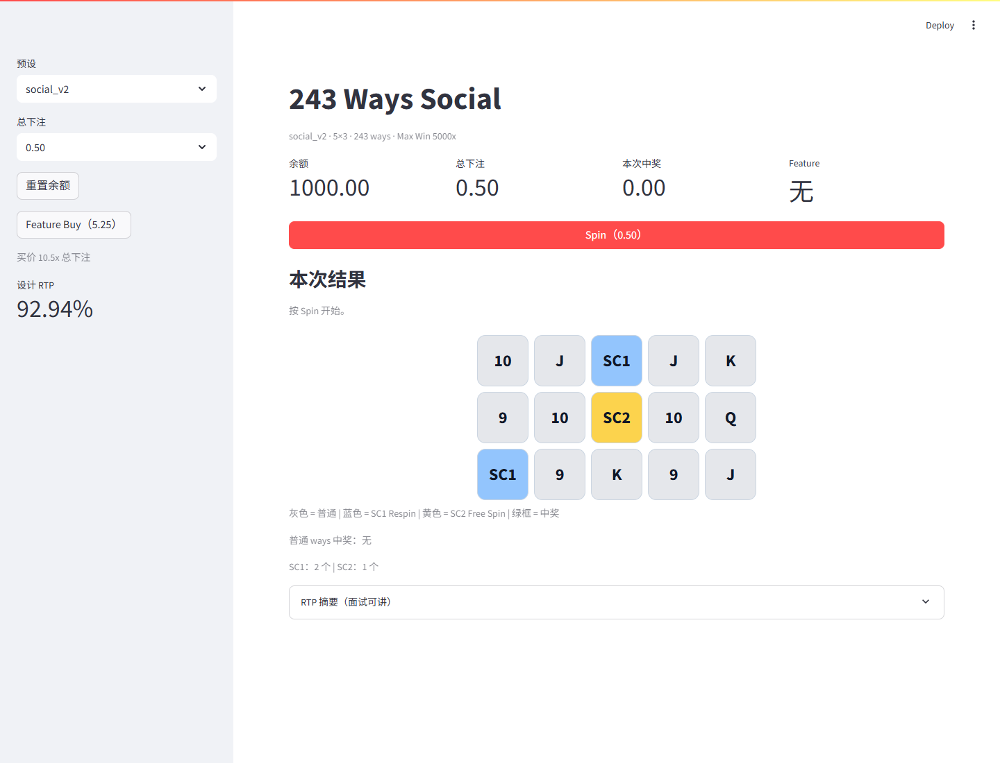

# Social Slots - 243 Ways

[](https://github.com/xufushen521/social-slots-243ways/actions/workflows/tests.yml)

两个可直接运行的 5x3、243 ways Social Slots 数值原型：

- v1：纯 Base，低波动对照版。
- v2：SC1 Respin + SC2 Free Spin，高波动 Feature 版。

本项目仅用于数值设计、机制验证和求职作品展示，不包含真钱、兑换或提现功能。

| v1 纯 Base | v2 Respin + Free Spin |
|---|---|
|  |  |

## 下载后启动

### Windows

1. 点击页面右上角 `Code`，选择 `Download ZIP`。
2. 解压 ZIP。
3. 双击 `start_v1.bat` 或 `start_v2.bat`。
4. 首次运行会自动创建虚拟环境并安装 Streamlit，之后打开浏览器。
5. 如果没有自动打开，请访问 `http://localhost:8501`。

运行条件：Windows 10/11、Python 3.10 或更高版本、首次安装依赖时需要网络。

### macOS / Linux

```bash
cd v1  # 或 cd v2
python3 -m venv .venv
source .venv/bin/activate
python -m pip install -r requirements.txt
python -m streamlit run app.py
```

## 版本对比

| 指标 | v1 纯 Base | v2 Respin + Free Spin |
|---|---:|---:|
| 设计 RTP | 95.33% | 约 93.00% |
| 1M 模拟 RTP | 95.41% | 92.94% |
| Hit rate | 41.55% | 36.07% |
| SD | 2.51 | 2.88 |
| Feature 贡献 | 0% | 13.33% |
| Feature Buy RTP | - | 90.54% |
| Max Win | 1000x | 5000x |

## v2 规则

- SC1：触发 Respin。初始 3 次，SC1 粘住，新 SC1 续 1 次，最多 5 次。
- SC2：触发 Free Spin。6 次，普通 ways 奖 x2，不 retrigger。
- 两个 Feature 不嵌套；同一 Base Spin 同时触发时，Free Spin 优先。
- Feature Buy 仅购买 Free Spin，价格 10.5x 总下注。

## 文档

- [243 Ways 建模拆解 DOCX](docs/243ways_建模拆解.docx)
- [可复算工作簿 XLSX](docs/243ways_模型工作簿.xlsx)
- [v2 机制与商业流程 Draw.io](docs/v2_机制与商业流程.drawio)

`.drawio` 文件可在 [diagrams.net](https://app.diagrams.net/) 中打开。

## 目录

```text
v1/                    纯 Base 版本
v2/                    Respin + Free Spin 版本
docs/                  机制拆解、工作簿与流程图
start_v1.bat           Windows 一键启动 v1
start_v2.bat           Windows 一键启动 v2
```

每个版本均包含独立的 `app.py`、`config.json`、`engine/`、`scripts/` 和 `tests/`。

## 测试

```bash
cd v1
python -m unittest discover -s tests -v

cd ../v2
python -m unittest discover -s tests -v
```

计算结果属于可复算的原型参数，不是商业机台认证结果。代码和各自的 `config.json` 是当前版本的事实来源。

作者：许富深
